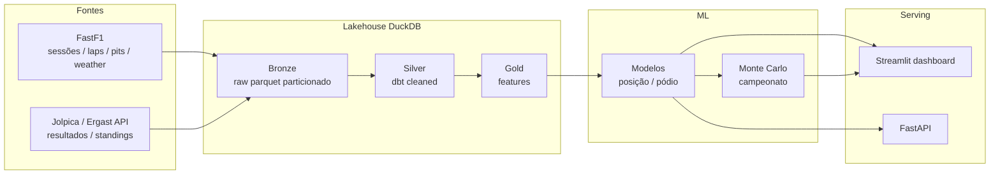

# f1-race-prediction-pipeline

Pipeline de **engenharia de dados + machine learning** para prever resultados da Fórmula 1 — portfólio de [Eric Guerrize](https://github.com/EricGuerrize), analista de dados no Brasil posicionando-se como perfil **data engineer + ML**.

> Dados não oficiais, uso de portfólio / não-comercial. Desenvolvido localmente com [Antigravity IDE](https://antigravity.google/).

## Pitch

Do timing de telemetria ao pódio simulado: este projeto ingere sessões FastF1 e resultados históricos (Jolpica/Ergast), organiza um lakehouse local em DuckDB (`bronze → silver → gold`), transforma com dbt, orquestra com Prefect e entrega modelos de posição de chegada / probabilidade de pódio + simulação de campeonato (Monte Carlo), servidos em Streamlit (e depois FastAPI).

**Fase 1 (atual):** ingestão + infraestrutura — CLI, parquet particionado, DuckDB, validação, sample offline, Docker e CI.

## Arquitetura (visão alvo)



### Layout bronze (fase 1)

```
data/bronze/<source>/<dataset>/season=YYYY/round=NN/part-000.parquet
data/warehouse.duckdb          # manifest + views bronze.*
data/sample/                   # amostra real trimada (offline / CI)
data/cache/fastf1/             # cache FastF1 (local, gitignored)
```

Fontes na fase 1: `fastf1` (`results`, `laps`, `pit_stops`, `stints`, `weather`) e `jolpica` (`results`, `driver_standings`).

## Roadmap

| Fase | Escopo | Status |
|------|--------|--------|
| **1** | Ingestão FastF1 + Jolpica, parquet bronze, DuckDB, schemas, CLI, sample, Docker, CI | **este PR** |
| **2** | Modelos dbt (dbt-duckdb) bronze→silver→gold + testes de qualidade | planejado |
| **3** | Features + baseline ML (posição / pódio) | planejado |
| **4** | Prefect (incremental por weekend), Streamlit, simulação de campeonato, FastAPI | planejado |

## Como rodar

Requisitos: Python 3.11+, [uv](https://github.com/astral-sh/uv), Make. Docker opcional.

```bash
git clone https://github.com/EricGuerrize/f1-race-prediction-pipeline.git
cd f1-race-prediction-pipeline
make setup          # uv sync --extra dev + pre-commit
make demo           # offline: copia data/sample → bronze + DuckDB
make test           # pytest (sem rede)
make lint
```

Ingestão real (rede + FastF1; pode demorar):

```bash
make ingest SEASON=2024 ROUND=1
# ou temporada:
make ingest SEASON=2024
# CLI direta:
uv run f1p ingest --season 2024 --round 1
uv run f1p status
```

A ingestão é **idempotente**: rounds já presentes em `meta.ingestion_manifest` são pulados (`--force` para reingerir). Requests Jolpica usam rate-limit + retry; FastF1 usa cache em `data/cache/fastf1`.

### Docker

```bash
docker compose run --rm f1-pipeline
# ou
make docker-build && docker run --rm f1-pipeline:local
```

## Pacote e CLI

- Pacote: `src/f1_pipeline`
- Entry point: `f1p` (Typer)
- Comandos: `ingest`, `demo`, `status`, `version`

```bash
uv run f1p --help
```

## Fontes de dados e atribuição

| Fonte | Uso | Licença / notas |
|-------|-----|-----------------|
| [FastF1](https://github.com/theOehrly/Fast-F1) | Sessões, laps, pits/stints, weather (2018+) | Biblioteca **MIT**. Dados de timing da F1 são **não oficiais**. |
| [Jolpica F1 API](https://api.jolpi.ca/ergast/f1/) | Resultados e standings (compatível Ergast) | API comunitária Ergast-compatible; respeitar rate limits. |
| Formula 1 | — | Marca e dados oficiais pertencem aos detentores de direitos. Este projeto é **portfólio / não-comercial** e **não é afiliado** à FIA/F1. |

O diretório `data/sample/` contém **3 rounds reais de 2024** (Bahrain, Jeddah, Australia): resultados/standings Jolpica + laps/pits reais trimados (~10 laps/piloto) no schema bronze FastF1, para demo e CI sem rede. Ver `data/sample/MANIFEST.md`.

## Stack (fase 1)

Python 3.11+ · uv · Typer · httpx · tenacity · pandas · pyarrow · DuckDB · Pandera · FastF1 · Ruff · pytest · pre-commit · Docker · GitHub Actions

## Desenvolvimento

```bash
make fmt            # ruff fix + format
make test
uv run python scripts/build_sample.py --rounds 1,2,3   # regenerar sample (rede)
```

Eric desenvolve este projeto localmente com a **Antigravity IDE**, usando este repositório como vitrine de engenharia de dados para recrutadores.

## Licença

[MIT](./LICENSE) © 2026 Eric Guerrize
